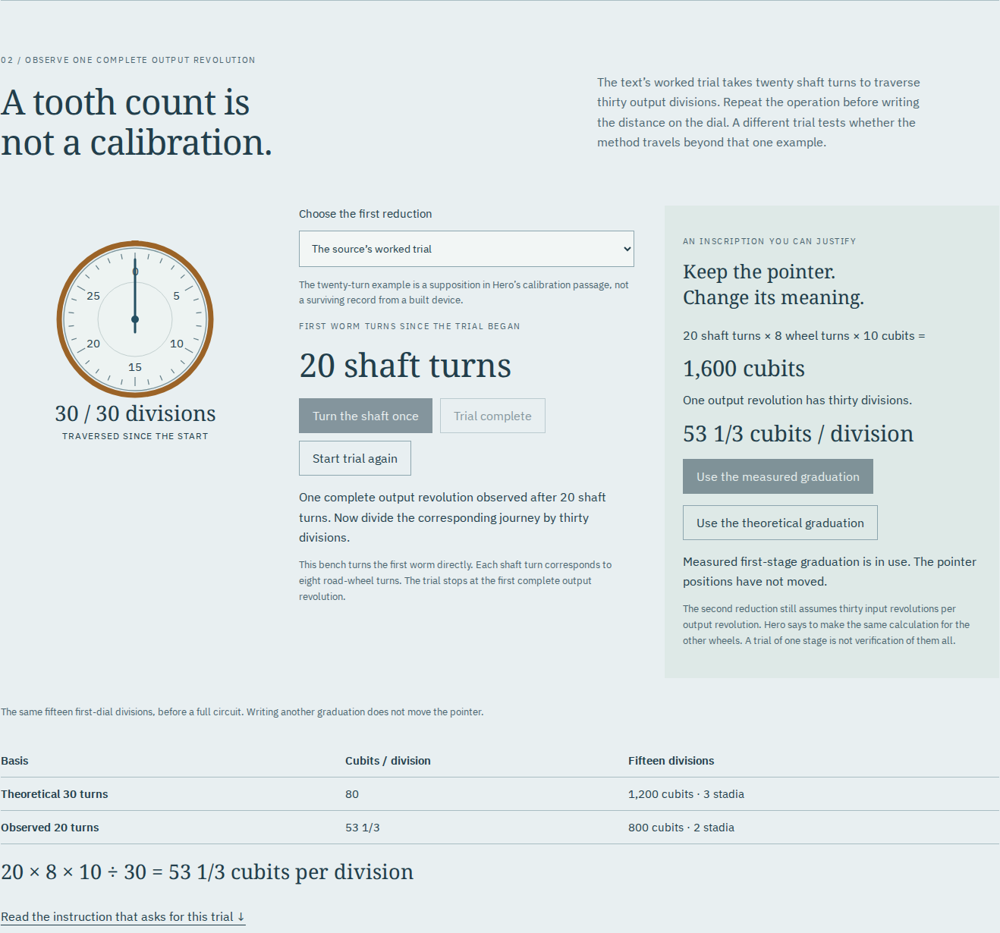
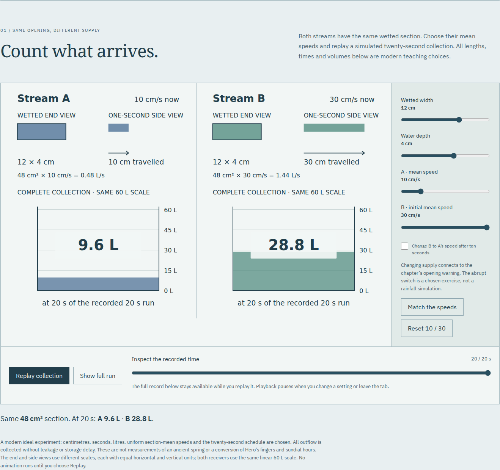

# Dioptra

**Measure what the instrument tells you.** Read Hero's Greek, aim an unseen
tunnel, collect water against time, and calibrate a distance counter by trial.

[Workshop](https://antonsoo.github.io/dioptra/) · [Code: MIT](LICENSE) ·
[Text and source licenses](public/sources/NOTICES.txt) · [Model](docs/model.md)

The long walk around a mountain is not the distance through it. Hero's
_Dioptra_ 15 uses right angles and signed distances to determine an unseen
triangle, then small similar triangles to establish the aiming lines outside.
This field book lets a learner perform those operations, read the Greek that
describes them, and distinguish the ideal proof from a deliberately displaced peg.


## Count the teeth. Then measure.

The third room, **`counter.html`**, follows _Dioptra_ 34. Hero first describes
a worm advancing one tooth per turn, then asks the operator to test the ratio.
His supposed trial takes **twenty turns** to move a **thirty-tooth** wheel
through one complete revolution. The distance written on its dial must change.

Open the [calibration workshop](https://antonsoo.github.io/dioptra/counter.html),
or run locally using the quickstart below.



Turn the shaft once at a time, or run the trial to its stopping mark. Apply
the measured graduation: the same fifteen divisions now read **800 cubits**,
where the uncorrected scale read **1,200**. Neither pointer moves when its
scale changes. Try a different, explicitly modern ratio to apply the procedure
beyond that one example.

Follow the eight-pin input and both reduction dials through a carry, then a
complete circuit. Both pointers return to zero; the separate outside ledger
shows the distance their positions cannot retain. The second reduction stays
at an explicitly assumed 30:1 ratio. Testing one stage does not verify them all.

Fourteen Greek-and-English selections explain the argument, its number
letters and the language of trial. Twelve full pages retain the Greek, facing
German, apparatus, a textual gap and the edition's cutaway. The verified
archive-leaf links distinguish printed p. 298 from marginal earlier-edition
p. 312. No missing construction or physical cause of the twenty-turn ratio
is invented.

Save the dials as SVG, checkpoints as CSV, or the complete illustrated reading
as one script-free HTML file, with scans, fonts and licenses embedded. The
three-room production edition saves all of its sources offline.

[Source and model](docs/counter-model.md) · [Development review](docs/counter-review.md) ·
[Publication review](docs/counter-publication.md) ·
[Actual saved reading](examples/counter-reading.html) ·
[22-page PDF](examples/counter-reading.pdf) ·
[Dials SVG](examples/counter.svg) · [Checkpoints CSV](examples/counter.csv).

## Water needs a clock

The [water-collection workshop](https://antonsoo.github.io/dioptra/flow.html)
reads **Dioptra 31**. Two equal stream sections collect
9.6 and 28.8 litres in twenty chosen modern seconds. Change the second flow
halfway through: the total becomes 19.2 litres, and the first ten seconds now
predict too much. Measure the first, last and whole intervals against the record.



Read the complete chapter in eleven Greek-and-English units, inspect four full
pages with the facing German, and investigate the printed **τάχος / πάχος**
(speed/thickness) distinction. Save a complete HTML reading, printable PDF,
receiver SVG or collection CSV. The centimetres, seconds and switching schedule
are explicit modern teaching choices, not measurements of an ancient spring.

[Model and source decisions](docs/flow-model.md) · [Review](docs/flow-review.md) ·
[Saved reading](examples/dioptra-flow-reading.html) ·
[Printable reading](examples/dioptra-flow-reading.pdf).

## Try the construction

1. **Walk around.** Select any of the seven measured legs. Move the bends: the
   default outside walk grows from 560 to 760 chosen metres, but the portals stay put.
2. **Cancel the detours.** Rightward minus leftward gives 300 metres; the
   perpendicular net is 60. The invisible triangle has ratio 5:1.
3. **Set the sights.** A 50-metre outside baseline needs a 10-metre perpendicular.
   Try another peg position, then use **Set from the ledger** to obtain the exact ratio.
4. **Meet in the middle.** Extend both lines. Add a chosen 10 mm error to both
   pegs and inspect the 60 mm vertical gap at the middle station.

The gap detail has its own scale. The main map retains equal horizontal and
vertical scales; a phone rotates the complete plan clockwise instead of cutting
off the circuit. Keyboard controls perform the same operations as the pointer.

| Default five-to-one example                      |      Result |
| ------------------------------------------------ | ----------: |
| Net plan displacement                            | 300 by 60 m |
| Near outside circuit                             |       560 m |
| Wide outside circuit                             |       760 m |
| Ideal connecting length                          |  305.9412 m |
| Ideal peg offset on a 50 m baseline              |        10 m |
| Middle gap: one peg displaced outward by 10 mm   |       30 mm |
| Middle gap: both pegs displaced outward by 10 mm |       60 mm |

Only the five-to-one **ratio** comes from Hero's numerical example. The metre
lengths, terrain outline, two- and seven-to-one exercises, and peg errors are
modern teaching choices. The circuit and its right angles remain exact in the
error experiment. No claim is made about ancient instrument precision or the
method actually used by Eupalinos at Samos.

## Read and inspect

Eight Greek excerpts have new English translations, word notes and grammar.
The readings explain a genitive absolute, a construction infinitive, the
understood noun in “at right angles”, a fivefold comparison and its reciprocal
fifth part, and the workers' final reciprocal “one another”. No Greek prerequisite
is assumed. Each reading opens its corresponding printed page.

Four complete pages from Hermann Schöne's 1903 edition retain figure 95,
the Greek, the facing German translation and the apparatus. The printed diagram
is schematic; its dimensions do not reproduce the text's numerical example.
The model also exposes a label difficulty: the perpendicular construction closes
at Μ, while subsequent printed distance lists use Λ. The field book sums the
actually constructed ΚΜ and ΜΔ legs and explains that reading decision.

The Greek digital edition is pinned to its source commit, with its complete
TEI file included. All eight excerpt sequences were checked against it; the
four JPEGs were reproduced from the identified complete PDF. See the
[source identities](public/sources/manifest.json) and [review](docs/review.md).

## Keep a real field book

Save the diagram as SVG or the stations, signed legs and measurements as CSV.
The illustrated HTML includes your survey, the exact comparison construction,
the meeting detail, all eight readings, all four printed pages, fonts and
redistribution notices. Its embedded CSV link works when opened from disk.
Images and fonts are verified before export. The app itself works offline
after its footer confirms the complete current edition.

[Actual saved HTML](examples/field-book.html) · [Printed PDF](examples/field-book.pdf) ·
[SVG](examples/survey.svg) · [CSV](examples/survey.csv).

## Run locally

With Node.js 24 or newer:

```sh
git clone https://github.com/antonsoo/dioptra.git && cd dioptra
npm ci
npm run dev
```

Open `http://127.0.0.1:4344/dioptra/`. Development does not install a service
worker. `npm run build` writes the complete static site to `dist/`, with base
`/dioptra/`. `npm run preview` serves that build on the same port; run development
and preview one at a time. No account, runtime service or external font request
is needed.

## How the calculation works

The circuit's signed horizontal and vertical legs telescope to the displacement
`(X,Y)` between portals. For an accessible baseline `b`, the ideal perpendicular
is `bY/X`. The external aiming points are `(-b,-bY/X)` and `(X+b,Y+bY/X)`.
Both point inward along the same line.

For a chosen ratio `a` and peg errors `eB,eD` in metres, the middle vertical gap
is `Xa - Y + X(eB+eD)/(2b)`. This isolates a wrong ratio from a displaced peg.
The extension control advances a fraction of each half's horizontal span; it
represents neither equal drilling distances nor an excavation schedule.

Pure geometry and bounded shared state are in [survey.ts](src/survey.ts).
Drawing, source content, file export and browser controls are separate modules.
The static edition hashes its complete source inventory and verifies every
cached file before declaring offline readiness.

## Verify

```sh
npm run check
npm run verify:survey
npm run verify:counter
npm run verify:counter-sources
npm run test:browser -- /tmp/dioptra-browser
node --import tsx scripts/print-review.ts /tmp/dioptra-browser/field-book.pdf
python3 scripts/source-review.py --online
```

The geometry oracle uses independent exact rational arithmetic for 576 settings,
including both signs of peg error, all affected-entrance choices and several
baseline lengths. Browser review exercises the drawn coordinates, native controls,
actual downloads, standalone files and a disconnected origin in Chromium and
Firefox at desktop and phone widths. Poppler and Python are needed for the print
and source reviews. Install the Playwright browser binaries if they are absent:
`npx playwright install chromium firefox`.

For the distance counter, run `npm run test:counter -- /tmp/dioptra-counter`.
It checks the actual calibration, unchanged pointer positions, carry and
rollover, a second trial ratio, keyboard controls, history and shared settings,
all fourteen readings and twelve source pages, native downloads, standalone
files, source-substitution rejection and a disconnected three-room edition in
both browsers at desktop and phone widths. Its independent rational oracle
checks 6,282 cases. The [counter review](docs/counter-review.md) includes the
source-image, printed-reading and previous-edition upgrade evidence.

## Limits, contribution and licensing

This is a planar interpretation of a textual construction, not an archaeological
reconstruction, elevation survey, error model for a real instrument, geological
simulation or engineering design. The numerical drawing supports exploration;
the source's similar-triangle reasoning supplies the proof. The PDF is a browser
print, not a tagged or separately typeset critical edition.

Corrections to source readings and consequential learner workflows are welcome.
Please include the edition/page or a reproducible example; see
[CONTRIBUTING](CONTRIBUTING.md). Code and new diagrams are MIT. Greek transcription
and new teaching text are CC BY-SA 4.0; historical pages are public domain, and
fonts retain their SIL Open Font License notices.
