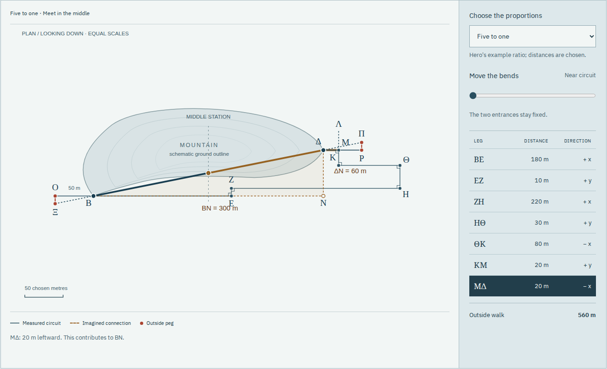

# Dioptra

**Meet beneath the mountain.** Read Hero's Greek instructions, measure an
outside circuit, and aim a tunnel between entrances that cannot see one another.

[Workshop](https://antonsoo.github.io/dioptra/) · [Code: MIT](LICENSE) ·
[Text and source licenses](public/sources/NOTICES.txt) · [Model](docs/model.md)

The long walk around a mountain is not the distance through it. Hero's
_Dioptra_ 15 uses right angles and signed distances to determine an unseen
triangle, then small similar triangles to establish the aiming lines outside.
This field book lets a learner perform those operations, read the Greek that
describes them, and distinguish the ideal proof from a deliberately displaced peg.



## Try the construction

1. **Walk around.** Select any of the seven measured legs. Move the bends: the
   default outside walk grows from 560 to 760 chosen metres, but the portals stay put.
2. **Cancel the detours.** Rightward minus leftward gives 300 metres; the
   perpendicular net is 60. The invisible triangle has ratio 5:1.
3. **Set the sights.** A 50-metre outside baseline needs a 10-metre perpendicular.
   Try another peg position, then use **Set from the ledger** to obtain the exact ratio.
4. **Meet in the middle.** Extend both lines. Add a chosen 10 mm error to both
   pegs and inspect the 60 mm vertical gap at the middle station.

The gap detail has its own scale. The main map retains equal horizontal and
vertical scales; a phone rotates the complete plan clockwise instead of cutting
off the circuit. Keyboard controls perform the same operations as the pointer.

| Default five-to-one example                      |      Result |
| ------------------------------------------------ | ----------: |
| Net plan displacement                            | 300 by 60 m |
| Near outside circuit                             |       560 m |
| Wide outside circuit                             |       760 m |
| Ideal connecting length                          |  305.9412 m |
| Ideal peg offset on a 50 m baseline              |        10 m |
| Middle gap: one peg displaced outward by 10 mm   |       30 mm |
| Middle gap: both pegs displaced outward by 10 mm |       60 mm |

Only the five-to-one **ratio** comes from Hero's numerical example. The metre
lengths, terrain outline, two- and seven-to-one exercises, and peg errors are
modern teaching choices. The circuit and its right angles remain exact in the
error experiment. No claim is made about ancient instrument precision or the
method actually used by Eupalinos at Samos.

## Read and inspect

Eight Greek excerpts have new English translations, word notes and grammar.
The readings explain a genitive absolute, a construction infinitive, the
understood noun in “at right angles”, a fivefold comparison and its reciprocal
fifth part, and the workers' final reciprocal “one another”. No Greek prerequisite
is assumed. Each reading opens its corresponding printed page.

Four complete pages from Hermann Schöne's 1903 edition retain figure 95,
the Greek, the facing German translation and the apparatus. The printed diagram
is schematic; its dimensions do not reproduce the text's numerical example.
The model also exposes a label difficulty: the perpendicular construction closes
at Μ, while subsequent printed distance lists use Λ. The field book sums the
actually constructed ΚΜ and ΜΔ legs and explains that reading decision.

The Greek digital edition is pinned to its source commit, with its complete
TEI file included. All eight excerpt sequences were checked against it; the
four JPEGs were reproduced from the identified complete PDF. See the
[source identities](public/sources/manifest.json) and [review](docs/review.md).

## Keep a real field book

Save the diagram as SVG or the stations, signed legs and measurements as CSV.
The illustrated HTML includes your survey, the exact comparison construction,
the meeting detail, all eight readings, all four printed pages, fonts and
redistribution notices. Its embedded CSV link works when opened from disk.
Images and fonts are verified before export. The app itself works offline
after its footer confirms the complete current edition.

[Actual saved HTML](examples/field-book.html) · [Printed PDF](examples/field-book.pdf) ·
[SVG](examples/survey.svg) · [CSV](examples/survey.csv).

## Run locally

With Node.js 24 or newer:

```sh
git clone https://github.com/antonsoo/dioptra.git && cd dioptra
npm ci
npm run dev
```

Open `http://127.0.0.1:4344/dioptra/`. Development does not install a service
worker. `npm run build` writes the complete static site to `dist/`, with base
`/dioptra/`. `npm run preview` serves that build on the same port; run development
and preview one at a time. No account, runtime service or external font request
is needed.

## How the calculation works

The circuit's signed horizontal and vertical legs telescope to the displacement
`(X,Y)` between portals. For an accessible baseline `b`, the ideal perpendicular
is `bY/X`. The external aiming points are `(-b,-bY/X)` and `(X+b,Y+bY/X)`.
Both point inward along the same line.

For a chosen ratio `a` and peg errors `eB,eD` in metres, the middle vertical gap
is `Xa - Y + X(eB+eD)/(2b)`. This isolates a wrong ratio from a displaced peg.
The extension control advances a fraction of each half's horizontal span; it
represents neither equal drilling distances nor an excavation schedule.

Pure geometry and bounded shared state are in [survey.ts](src/survey.ts).
Drawing, source content, file export and browser controls are separate modules.
The static edition hashes its complete source inventory and verifies every
cached file before declaring offline readiness.

## Verify

```sh
npm run check
npm run verify:survey
npm run test:browser -- /tmp/dioptra-browser
node --import tsx scripts/print-review.ts /tmp/dioptra-browser/field-book.pdf
python3 scripts/source-review.py --online
```

The geometry oracle uses independent exact rational arithmetic for 576 settings,
including both signs of peg error, all affected-entrance choices and several
baseline lengths. Browser review exercises the drawn coordinates, native controls,
actual downloads, standalone files and a disconnected origin in Chromium and
Firefox at desktop and phone widths. Poppler and Python are needed for the print
and source reviews. Install the Playwright browser binaries if they are absent:
`npx playwright install chromium firefox`.

## Limits, contribution and licensing

This is a planar interpretation of a textual construction, not an archaeological
reconstruction, elevation survey, error model for a real instrument, geological
simulation or engineering design. The numerical drawing supports exploration;
the source's similar-triangle reasoning supplies the proof. The PDF is a browser
print, not a tagged or separately typeset critical edition.

Corrections to source readings and consequential learner workflows are welcome.
Please include the edition/page or a reproducible example; see
[CONTRIBUTING](CONTRIBUTING.md). Code and new diagrams are MIT. Greek transcription
and new teaching text are CC BY-SA 4.0; historical pages are public domain, and
fonts retain their SIL Open Font License notices.
