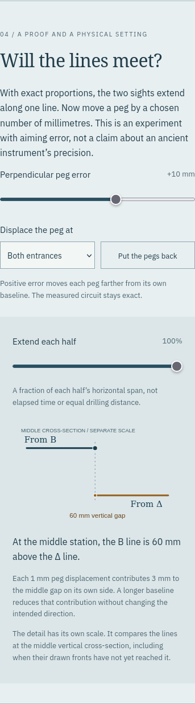
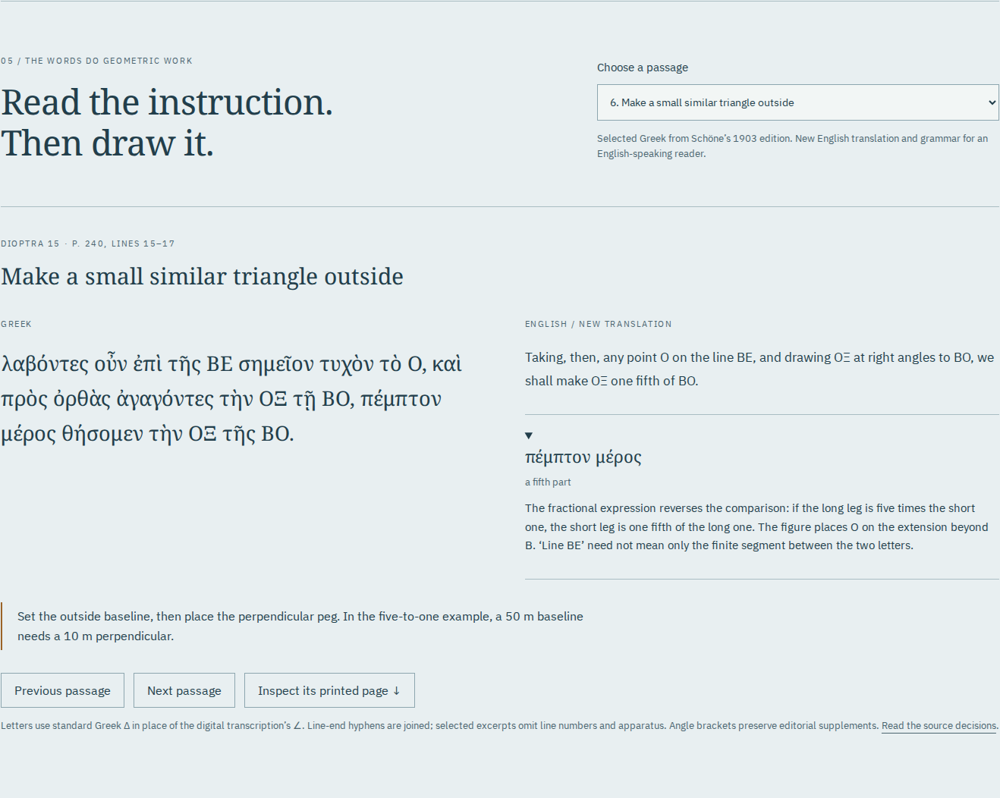

# Dioptra: a survey that can be inspected

Reviewed 23 October 2026. Runtime: `7c3a0113473b923f7b0ad85e031cf095330d6382`.
The [build inventory](review/build.json) identifies all 18 files, 2,425,258 bytes.
A clean archive installed and passed `npm run check` on Node 24.21.0; its complete
output matches the working build byte for byte. This is local evidence, not a CI result.

## What the learner can do

An outside walk of 560 chosen metres becomes 760 metres when its bends move,
while the displacement remains 300 by 60. The ledger cancels opposite directions.
Its 5:1 ratio determines a 10-metre perpendicular on a 50-metre outside baseline.
Both exact aiming lines then coincide. Displacing both pegs outward by a chosen
10 mm separates their lines by 60 mm at the middle vertical cross-section.
One displaced peg gives 30 mm. These are geometry results, not ancient measurements.

The phone rotates the plan with equal horizontal and vertical scales. Greek
letters stay upright. The enlarged meeting detail deliberately has its own scale.

## Source and model review

The four complete source pages were read visually. `python3
scripts/source-review.py --online` downloaded the identified volume and pinned
Greek TEI, reproduced all four JPEGs byte for byte, verified seven bundled source
files, and checked all eight excerpt letter/diacritic sequences within chapter 15.
The [receipt](review/sources.json) and [manifest](../public/sources/manifest.json)
record the identities and rendering recipe. Punctuation is not tested by that
sequence comparison; the source images remain available for inspection.

The discrepancy between the constructed Μ and the later printed distance lists
using Λ is discussed beside the ledger and in the [model](model.md). Figure 95 is
schematic. Neither the metre dimensions nor the peg-error experiment is attributed
to Hero. English translations and grammatical notes are new teaching text.

`npm run verify:survey` compared 576 settings and 19,008 quantities with independent
Python rational calculations, including both signs of error and one or both
affected entrances. The largest absolute numeric discrepancy was
2.9103830456733704e-11, below 1e-9; this includes quantities with different units,
such as squared lengths. See the [oracle receipt](review/oracle.json). Seven unit
cases cover the geometrical invariants, shared-state bounds and export contents.

## Real browser and file workflows

`npm run test:browser -- /tmp/dioptra-browser` ran Chromium 153.0.8010.12 and
Firefox 155.0 at 1440 and 375 pixels. Each configuration inspected 36 drawn circuit
states, plus peg-error and extension changes. It inverted actual SVG coordinates,
checked equal display scales, and exercised native controls, decimal typing,
keyboard changes, invalid-input recovery and shared-state reload.

All eight Greek/English readings, the four source-image hashes, zoom and passage
navigation were checked. Actual SVG, CSV and HTML downloads were opened. The
standalone HTML retained four verified images, fonts, licenses and a working CSV
download with the same bytes as the direct CSV. SVG parsed as XML with its styles.
After disconnecting the serving origin, reload, source viewing, model changes and
a new complete HTML export still worked. No external requests or page errors
occurred; automated WCAG A/AA checks reported no violations. This is not a claim
of complete accessibility conformance. [Browser receipt](review/browser.json).

Both browsers also received a substituted HTTP-200 source image: export refused
it. Holding one file during installation kept offline readiness false until the
complete edition could be verified. A successful response alone is insufficient.

The [saved field book](../examples/field-book.html) is an actual Chromium download.
Its [13-page PDF](../examples/field-book.pdf) was printed from that file and read
visually. Poppler extraction confirms all 48 complete Greek, English, word, gloss,
grammar and action fields. See the [print receipt](review/print.json). It is a
browser print, not a tagged PDF or critical edition. Example CSV and SVG preserve
the same chosen state as the HTML.

## Publication

The public repository is [antonsoo/dioptra](https://github.com/antonsoo/dioptra).
Pages deployment `5326e45` serves the [workshop](https://antonsoo.github.io/dioptra/).
All 18 public files matched the reviewed build by SHA-256 over direct HTTPS.
Chromium and Firefox at 1440 and 375 pixels then exercised native controls,
actual HTML/SVG/CSV downloads, the saved HTML’s embedded CSV, and a reload with
another printed source page after disconnecting the network. All four passed.
The [hosted receipt](review/hosted.json) records this separately from local review.
Reproduce with `node scripts/hosted-review.mjs /tmp/dioptra-hosted`.
